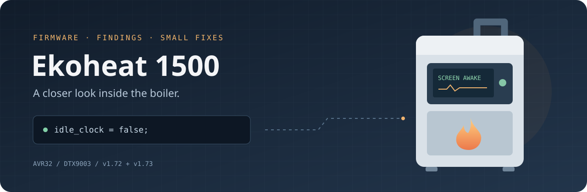

<!-- Generated with blah. Edit the blah field in package.json or .blah/README.ejs, then run npm run readme. -->

[](#fire-why-this-exists)

# Ekoheat 1500

[](https://www.patreon.com/ionicabizau) [](https://github.com/IonicaBizau/ama) [](analysis/v1.73/comparison.md) [](analysis/patched/v2.73/README.md)

> Reverse engineering, firmware notes, and small quality-of-life patches for the Ekoheat 1500 pellet boiler.

## :fire: Why this exists

I own an **Ekoheat 1500 pellet boiler**, and I wanted to personalize it more for my needs. So I started looking into its DTX9003 firmware, figuring out how it works, and making a few small changes.

The first thing I wanted: **keep the current screen visible instead of switching to the idle clock**. :)

This repo is where I keep my notes, tools, firmware comparisons, and patches. I have checked the patches offline, but **I have not tested them on the controller or checked whether the bootloader accepts them**.

## :sparkles: What is inside

Here is what I have put together so far:

- A **v1.72 → v1.73 comparison**, covering low-fuel warnings, status messages, pump control, and UI changes.
- **Patches for v1.72 and v1.73** that keep the screen awake and give the ash plate more time to open: 30 seconds beyond the configured movement time, up from 10.
- Disassembly, decompiled routines, hashes, and checksums so you can follow the findings.
- Manuals and notes about ignition, touchscreen calibration, wiring, and the images used by the display.

## :cloud: Getting started

You need **Python 3.6+** for the patch scripts. They use the standard library; Node.js is only needed to regenerate this README.

```sh
git clone https://github.com/ionicabizau/ekoheat-boiler-1500.git
cd ekoheat-boiler-1500
```

Start with the [firmware comparison](analysis/v1.73/comparison.md), [changelog](CHANGELOG.md), or [interesting findings](FUN_FACTS.md).

## :wrench: Keep the screen awake and give the ash plate more time on v1.73

Run from the repository root:

```sh
python3 analysis/tools/patch_v173_30s.py
python3 analysis/tools/verify_patch.py --version 1.73
```

This creates [`DTX9003.uc3`](analysis/patched/v2.73/DTX9003.uc3). It keeps the current screen visible and increases the ash-plate opening allowance from 10 to **30 seconds beyond the configured movement time**. For a 10-second movement setting, the nominal opening fault point is 40.2 seconds, including the existing loop timing. This is not a 30-second total opening limit.

The script checks the source hash and CRC32, leaves the original untouched, and records the changes in a [JSON manifest](analysis/patched/v2.73/DTX9003.json). See the [patch notes](analysis/patched/v2.73/README.md) for instruction details and verification results. Closing checks and ignition behavior are unchanged.

The combined image displays **v2.73** to distinguish it from the original firmware.

## :hourglass_flowing_sand: The same changes on v1.72

```sh
python3 analysis/tools/patch_firmware.py
python3 analysis/tools/verify_patch.py
```

This produces [`DTX9003.uc3`](analysis/patched/v1.72.42/DTX9003.uc3). I also increased the ash-plate opening allowance to 30 seconds beyond the configured movement duration. This changes motor fault timing; read the [full patch notes](analysis/patched/v1.72.42/README.md) for the details.

Offsets and patch instructions are specific to each source image. Both generators refuse a source with a different SHA-256.

The combined image displays **v1.72.42**. Both custom revision labels preserve the original build date.

## :floppy_disk: Update the boiler software

I wrote down the [USB update procedure](docs/updating-firmware.md), including which patched image and `license.key` to use, the original `DTX9003.uc3` filename, and the controller menu steps.

**Record your settings first:** the manual warns that an update can reset everything and select Ekoheat 900. Check the model is **Ekoheat 1500** and restore the pellet calibration before restarting.

The guide follows the supplied manuals. I have not flashed these patches or verified bootloader/license-file acceptance on hardware.

## :mag: What the binaries tell us

| Finding | Evidence |
| --- | --- |
| Ignition detection uses a processed light threshold of 18 lux; three failed attempts can produce “Startup failed!” | [Startup analysis](analysis/startup-failure.md) |
| Three ash-plate endstop activations within five seconds appear to request touchscreen recalibration on next startup | [Calibration notes](FUN_FACTS.md) |
| v1.73 adds low-fuel warning and expanded communication/status fields | [Version comparison](analysis/v1.73/comparison.md) |
| v1.73 adds start/standby/shutdown reactions to a digital input | [Input analysis](analysis/v1.73/comparison.md#additional-response-to-digital-input-gpio-0x20) |
| One manual documents an ambient thermostat connection on J1 terminals 8–9 | [Manual index](docs/README.md) |

The mapping between that thermostat connection and firmware GPIO `0x20` is **unconfirmed**. Remote error acknowledgement is also unverified. A physical safety cut-out may require a physical reset; clearing a UI message does not repair its cause.

## :file_folder: Repository map

| Path | Contents |
| --- | --- |
| [`DTX9003 v1.72/`](DTX9003%20v1.72) | Original v1.72 firmware |
| [`DTX9003 v1.73/`](DTX9003%20v1.73) | Original v1.73 firmware |
| [`analysis/tools/`](analysis/tools) | Python patch/analysis scripts and SLEIGH disassembler source |
| [`analysis/patched/`](analysis/patched) | Derivatives, manifests, and patch evidence |
| [`analysis/v1.73/`](analysis/v1.73) | Version comparison and decompiled v1.73 routines |
| [`analysis/ghidra/`](analysis/ghidra) | Original v1.72 disassembly and decompiled routines |
| [`analysis/assets/`](analysis/assets) | Extracted RGB565 bitmap previews and HTML viewer |
| [`docs/`](docs) | Boiler manuals and display datasheet |

See [analysis setup and reproduction](analysis/README.md) for the distinction between Python-only tools and the native Ghidra tooling. The supplied `license.key` files are included in their firmware folders. They are not needed for offline analysis or patch generation. Local native builds, generated XML images, and caches are excluded from Git.

## :memo: Regenerate this README

I use [`blah`](https://github.com/ionicabizau/blah) for this README. Edit the **`blah` field in [`package.json`](package.json)**, or [`.blah/README.ejs`](.blah/README.ejs) for layout changes, then run:

```sh
npm ci
npm run readme
```

Commit the generated README along with the source changes.

## :yum: How to contribute

Found another firmware version, figured out an input, or noticed something I got wrong? [Open an issue](https://github.com/ionicabizau/ekoheat-boiler-1500/issues) or send a pull request. Please include the firmware hash and how you reached your conclusion.

See [CONTRIBUTING.md](CONTRIBUTING.md) for the details.

## :sparkling_heart: Support my projects

If this project helps, give it a star or share what you discover. :heart:

[Support me on Patreon](https://www.patreon.com/ionicabizau) · [Buy me a coffee](https://www.buymeacoffee.com/H96WwChMy) · [PayPal](https://www.paypal.com/cgi-bin/webscr?cmd=_s-xclick&hosted_button_id=RVXDDLKKLQRJW)

## :scroll: License

Original project scripts, documentation, and header artwork: [MIT](LICENSE) © [Ionică Bizău](https://ionicabizau.net).

Vendor firmware, patched derivatives, extracted assets, and supplied manuals retain their respective owners’ rights and are excluded from that license grant. See [THIRD_PARTY.md](THIRD_PARTY.md). This project is not affiliated with or endorsed by Ekopower.

Copyright © Ekoheat. The original firmware binaries and the underlying firmware in patched images remain Ekoheat’s property and are not covered by this project’s MIT license.

I downloaded firmware from [NH Bioservice’s Ecoheat 900 / 1500 / 2500 page](https://www.nhbioservice.dk/pillefyr/ecoheat-900-1500-2500/), which provides version 1.72. I requested version 1.73 through [ekoheat.dk](https://ekoheat.dk/), and KESA ApS shared it with me by email from [kesa@kesa.dk](mailto:kesa@kesa.dk).
